# Tugas: API Daftar Produk dengan Prisma

REST API sederhana untuk mengelola data produk, dibuat dengan Express dan Prisma. Data disimpan di database PostgreSQL (Neon), bukan lagi di array.

**Nama:** Keisya Dira Anugerah
**NRP:** 5027251055

## Tech Stack

| Bagian | Pilihan |
|---|---|
| Runtime | Node.js |
| ORM | Prisma 7 dengan `@prisma/adapter-neon` |
| Database | PostgreSQL di Neon |

## Struktur Project

```
express/
├── images/                          
├── prisma/
│   ├── migrations/
│   └── schema.prisma                
├── src/
│   ├── config/prisma.ts             
│   ├── controllers/products.controller.ts   
│   ├── routes/products.routes.ts    
│   └── index.ts                     
├── .env                             
├── prisma.config.ts
├── package.json
└── tsconfig.json
```

Route hanya memetakan path ke fungsi, sedangkan controller berisi logika dan akses database lewat Prisma.

## Cara Menjalankan

1. Clone repository, lalu install dependency:

   ```bash
   npm install
   ```

2. Buat file `.env` di root project:

   ```env
   DATABASE_URL="connection string Neon (pooled)"
   DATABASE_URL_UNPOOLED="connection string Neon (direct)"
   PORT=3000
   ```

   `DATABASE_URL` dipakai aplikasi (host mengandung `-pooler`). `DATABASE_URL_UNPOOLED` dipakai Prisma CLI untuk migrasi.

3. Jalankan migrasi dan generate Prisma Client:

   ```bash
   npx prisma migrate dev --name init
   npx prisma generate
   ```

4. Jalankan server:

   ```bash
   npm run dev
   ```

   Server berjalan di `http://localhost:3000`.

## Skema Database

```prisma
model Product {
  id    Int    @id @default(autoincrement())
  name  String
  price Int
}
```

## Daftar Endpoint

| Method | Endpoint | Keterangan | Status |
|---|---|---|---|
| GET | `/products` | Menampilkan seluruh produk | 200 |
| GET | `/products/:id` | Menampilkan satu produk | 200, 400 (id tidak valid), 404 (tidak ditemukan) |
| POST | `/products` | Membuat produk baru | 201, 400 (input tidak valid) |
| PUT | `/products/:id` | Mengubah produk yang sudah ada | 200, 400 (id atau input tidak valid), 404 (tidak ditemukan) |
| DELETE | `/products/:id` | Menghapus produk | 200, 400 (id tidak valid), 404 (tidak ditemukan) |

### Body untuk POST dan PUT

```json
{ "name": "Buku", "price": 15000 }
```

- `name`: teks, tidak boleh kosong
- `price`: bilangan bulat, tidak boleh negatif

Pada PUT, `id` dikirim lewat URL (`PUT /products/1`), sedangkan body-nya sama seperti POST.

### Contoh Response

Sukses (`POST /products`, status 201):

```json
{ "id": 1, "name": "Buku", "price": 15000 }
```

Gagal (status 400 atau 404):

```json
{ "message": "Produk tidak ditemukan" }
```

## Dokumentasi

Pengujian dilakukan dengan Postman. Perubahan database dicek lewat Prisma Studio (`npx prisma studio`).

### 1. GET: Menampilkan Seluruh Produk

**GET `/products`** (200)

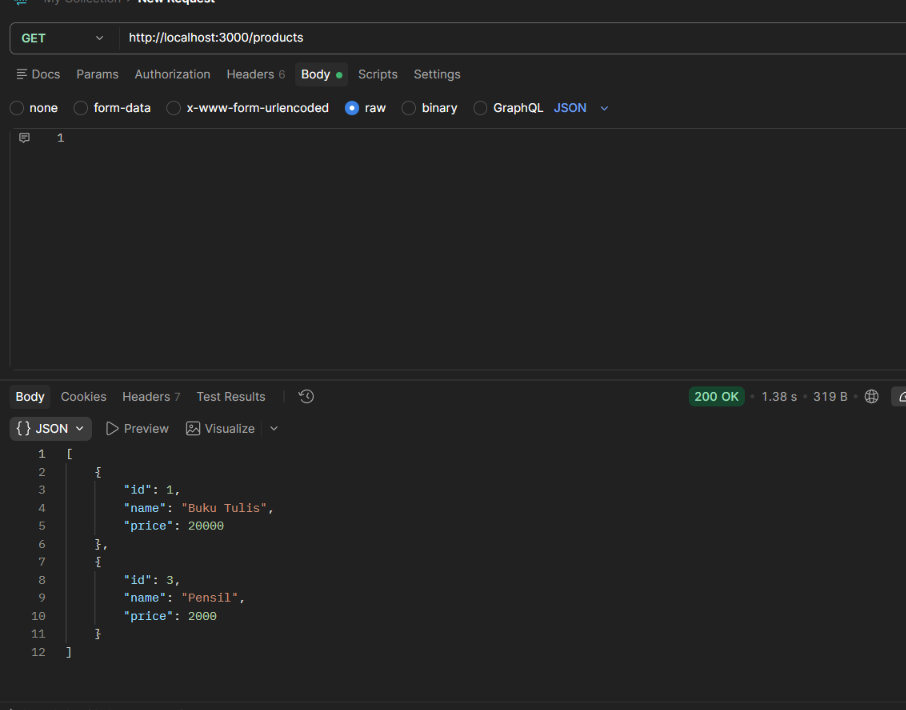

### 2. GET: Menampilkan Produk Berdasarkan ID

**GET `/products/1`** (200)

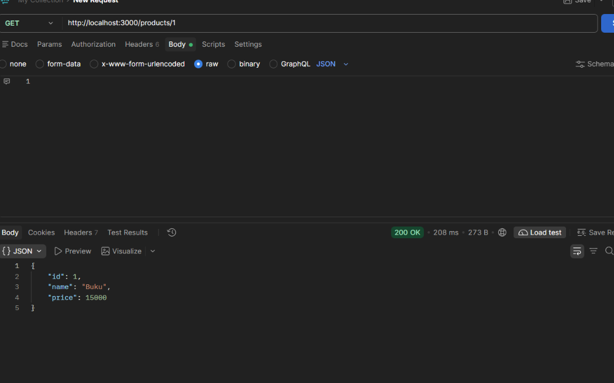

**GET `/products/999`** (404, produk tidak ditemukan)

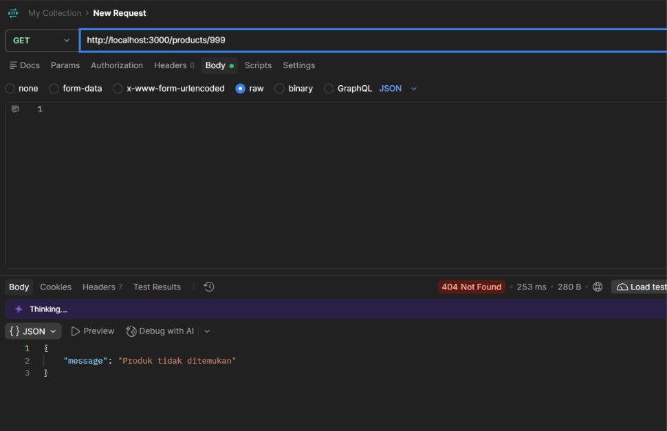

### 3. POST: Membuat Produk Baru

Database sebelum POST:

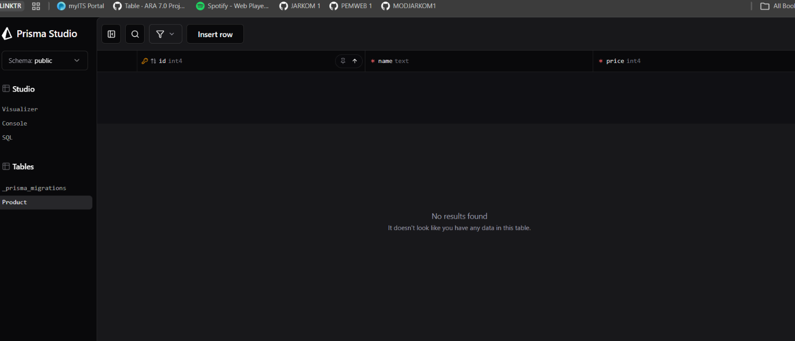

**POST `/products`** dengan body valid (201)

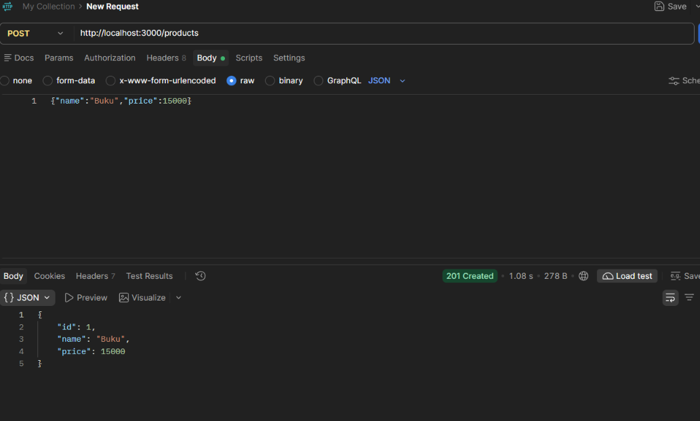

Database sesudah POST:

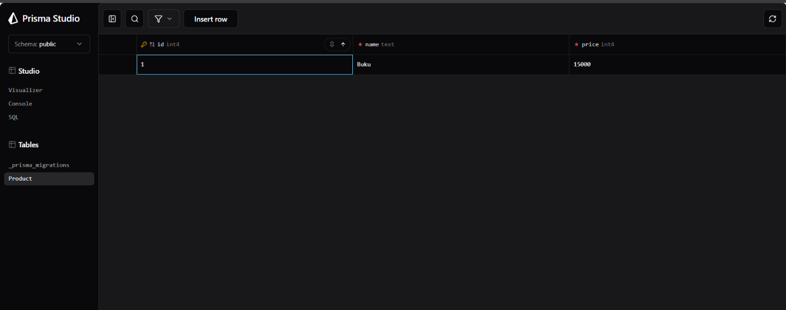

**POST `/products`** dengan body kosong (400, kesalahan validasi)

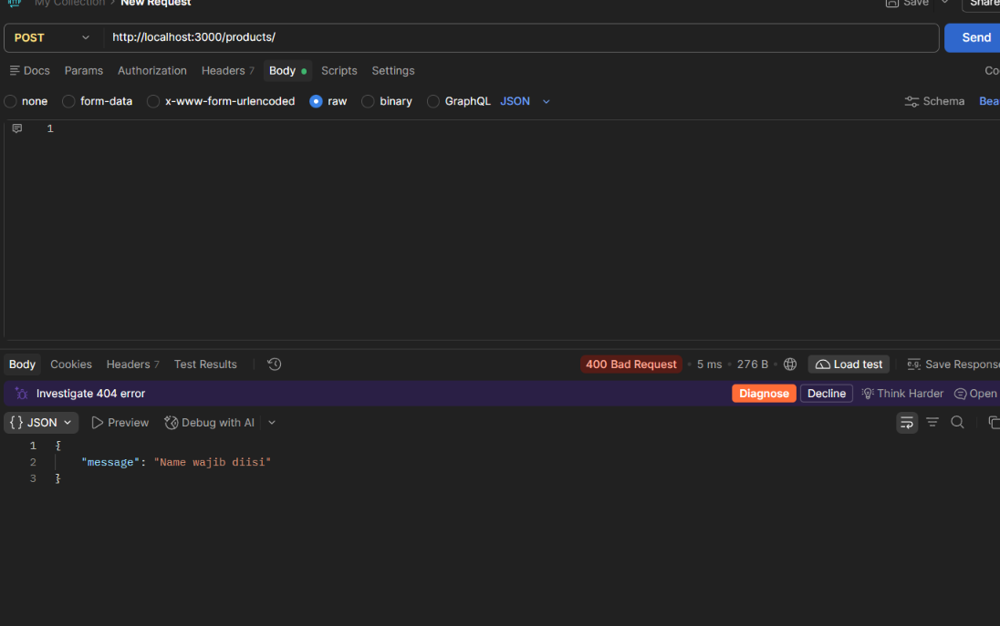

### 4. PUT: Mengubah Produk

Database sebelum PUT:


**PUT `/products/1`** dengan body valid (200)

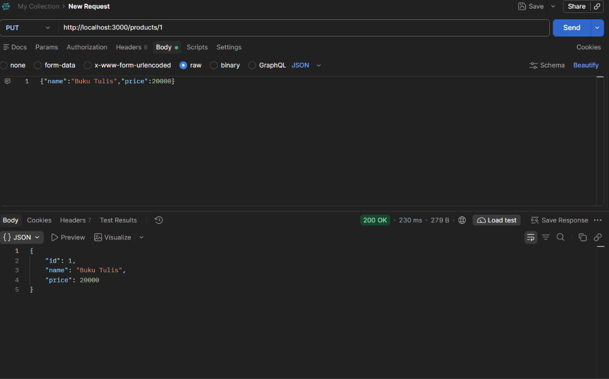

Database sesudah PUT:

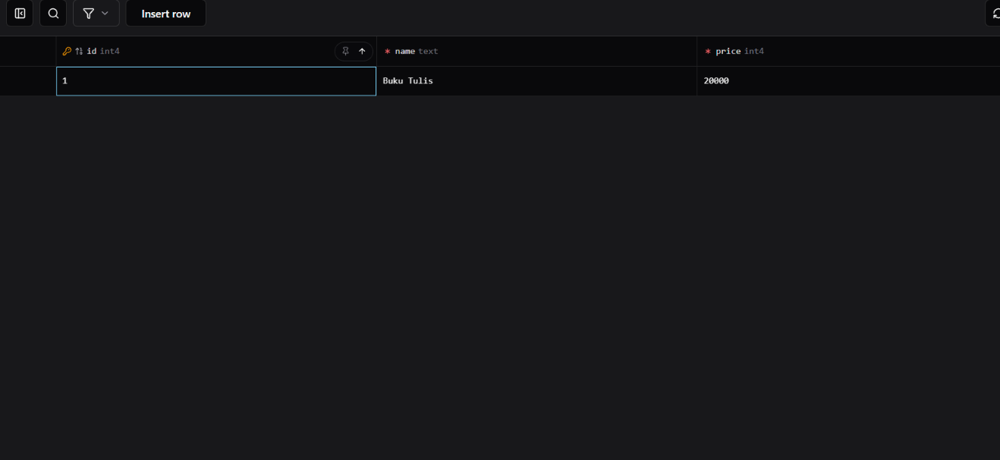

**PUT `/products/999`** (404, produk tidak ditemukan)

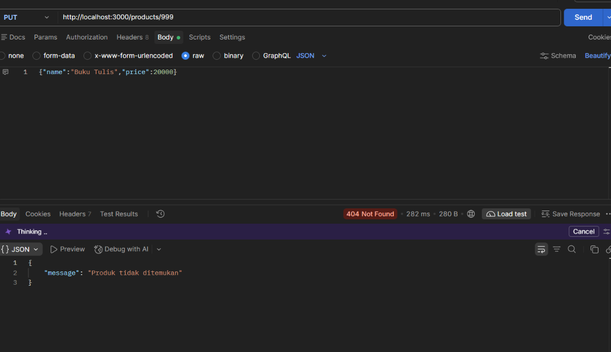


### 5. DELETE: Menghapus Produk

Database sebelum DELETE:

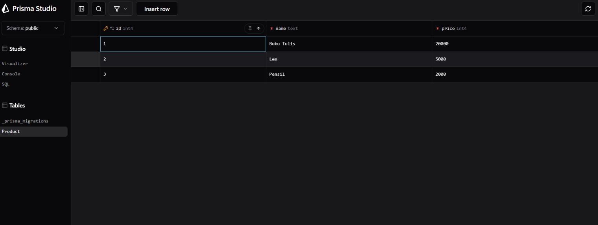

**DELETE `/products/2`** (200)

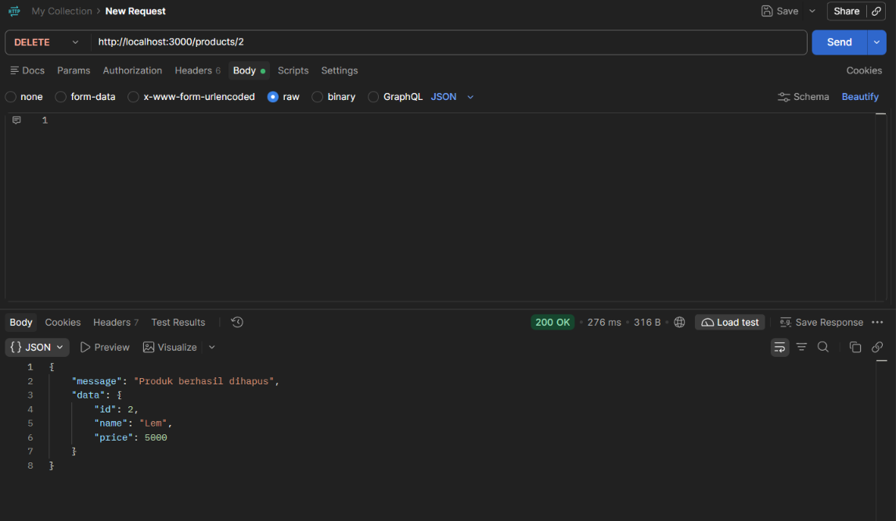

Database sesudah DELETE:

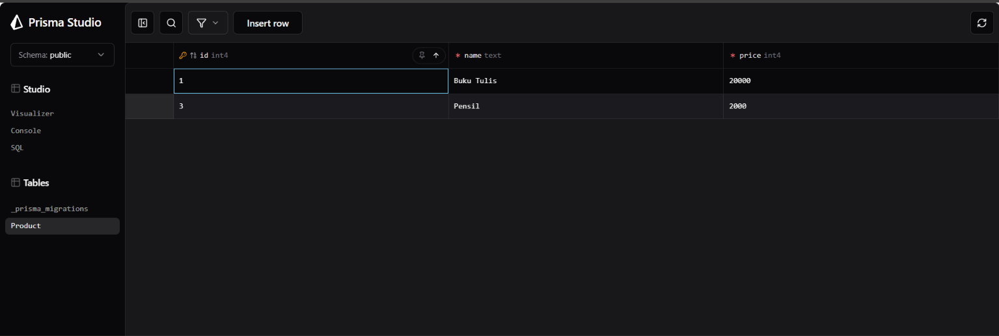
